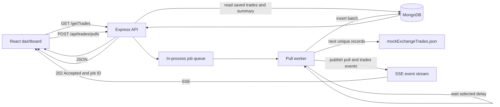

# Architecture Note

## Diagram


## App Structure

```text
Backend/
|-- app.js                    Express app and route registration
|-- Controller/trade.js       Trade reads, pull requests, and SSE handler
|-- Routes/traderoute.js      /api/trades routes
|-- Schema/tradeschema.js     MongoDB trade model
|-- data/
|   |-- trades.json           Initial seed data (1,000 records)
|   `-- mockExchangeTrades.json  Additional fixed exchange records
`-- lib/
    |-- db_connect.js          MongoDB connection
    |-- seeddata.js            Loads trades.json into MongoDB
    |-- mock_exchange.js       Supplies the next fixture batch
    |-- pull_worker.js         Processes delayed pull jobs
    `-- pull_events.js         Sends and briefly buffers SSE events

Frontend/
|-- src/pages/TradesDashboard.jsx  Dashboard page and state
|-- src/components/                Header, summary, table, pull controls/status
|-- src/services/tradesApi.js      HTTP and SSE calls
|-- src/pages/*.css                Dashboard and responsive styles
|-- public/                        Logo and public assets
`-- vite.config.js                 Local development API proxy

docs/architecture.md              This architecture note
README.md                          Setup, endpoints, and assignment notes
```

## Request Flow



## How a Pull Works

`POST /api/trades/pulls` checks the batch size and delay, queues a job in memory, and responds with `202 Accepted`. The worker processes jobs in order, waits for the selected delay (up to 15 minutes), reads the next records from the separate exchange fixture, and inserts them into MongoDB. Existing dashboard reads continue while the worker waits.

After a successful insert, the worker publishes an SSE `trades` event. The dashboard refreshes its current page and summary in response, without polling or a manual refresh. Pull progress is sent as `pull` events.

## Routes

- `GET /getTrades` reads saved trades from MongoDB. It supports `page`, `limit`, `search`, and `symbol`; omitting `page` and `limit` returns all matching records. The dashboard uses this endpoint.
- `GET /api/trades` is a compatibility alias for the same saved-trades handler.
- `POST /api/trades/pulls` queues a delayed fixture pull.
- `GET /api/trades/events` streams pull and trade events. The server keeps the latest 100 events in memory and replays events newer than the browser's `Last-Event-ID` after reconnect.
- `GET /api/health` returns a small health response.

## Timeout and Reconnect Behavior

The pull request responds before the worker's delay begins, so the HTTP request does not remain open during a long pull. SSE uses a 20-second heartbeat and browser `EventSource` reconnects automatically. The event replay buffer is limited to 100 events and is lost on backend restart; the queue and pull status are also in memory. A proxy that forcibly closes every connection at 30 seconds can still reconnect the stream, while the replay buffer helps deliver recent events missed during that reconnect.

## Assessment Fit and Known Limits

The app separates its 1,000-record initial seed from the additional 1,500-record mock exchange fixture, persists pulled batches to MongoDB, keeps existing records readable during pulls, and updates connected dashboards with SSE. The assessment describes the seed as “a few thousand”; the current seed has 1,000, so increase `trades.json` if the evaluator interprets that strictly as 2,000 or more. A video walkthrough is also a separate submission deliverable and is not in this repository.

This is a simple single-process demo. Restarting the backend loses queued jobs, event history, and the fixture cursor. A pull fails if fewer fixture records remain than its requested batch size.
