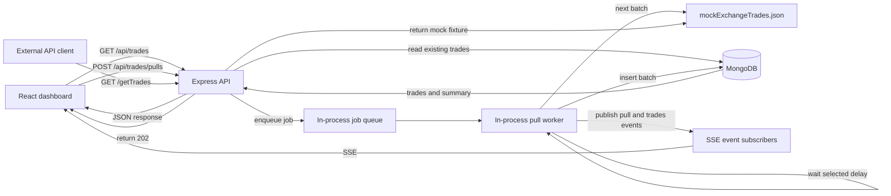

# Architecture Note

## Component Diagram

## Request and Background Processing

`POST /api/trades/pulls` validates `batchSize` and `delayMs`, adds a job to a process-local array queue, starts the worker if needed, and immediately returns HTTP `202` with a job ID. The worker handles jobs sequentially. For each job it publishes a `waiting` event, waits for the requested delay, publishes `processing`, takes the next fixture records, and inserts them into MongoDB. It then publishes a `trades` event with the inserted records and count. Errors are reported as a `failed` pull event.

The worker starts waiting as soon as the job reaches the front of its queue. The POST request returns without waiting for that delay or the database insert. This avoids holding the pull request open during the 15-minute maximum delay and means a network timeout on that request does not cancel work already queued in the backend process.

## Existing Trades During a Pull

The dashboard reads existing trades from MongoDB through `GET /api/trades`. A pull does not block this read route; the worker waits and later inserts its batch. Existing records remain visible during that wait. Once the insert succeeds, the dashboard receives the `trades` event and requests the current page and summary again.

`GET /getTrades` is a separate mock-exchange endpoint. It returns the complete fixed fixture wrapped in `{ "trades": [...] }`; the worker uses the same fixture module to select later pull batches.

## Real-Time Updates, Without Polling

The dashboard creates an `EventSource` connection to `GET /api/trades/events`. The backend registers each open response as a subscriber and broadcasts `pull` and `trades` events to those subscribers. It writes a comment heartbeat every 20 seconds and removes the subscriber when the response closes. The frontend refreshes its trade query only when it receives a successful `trades` event; there is no polling loop or cronjob.

SSE sends live events to connected browsers, but the current implementation does not store job state or replay events after a reconnect. A disconnected browser may need to reload to see a batch that completed while it was offline.

## 30-Second Network Timeout

The pull API does not wait for the worker: it queues a job and returns `202 Accepted` immediately. The delay and MongoDB write happen in the backend process afterward, so the 30-second limit does not terminate the pull request before the work finishes.

The dashboard's SSE stream is a separate, long-lived HTTP connection. The 20-second heartbeat helps prevent an idle timeout, but cannot prevent a proxy from enforcing a hard 30-second maximum connection lifetime. EventSource reconnects after a connection drop, but this app does not replay missed events.

## Trade Availability and Process Limits

MongoDB stores the initial seed and successfully inserted pull batches; dashboard reads continue to use that collection. The queue and mock fixture cursor are in memory, so pending jobs and pull status are not durable across a backend restart. This implementation is a single-process assessment demo and does not use a separate queue service.
